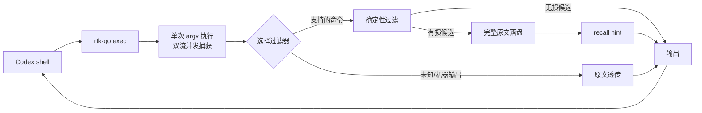

# rtk-go

**给 Codex CLI 用的命令输出压缩器。Go 1.25 独立实现，零第三方模块，单文件分发。**

`rtk-go` 参考 [RTK](https://github.com/rtk-ai/rtk) 的输出降噪思路，用 Go 重新实现并针对
Codex CLI 的 shell 结果做了取舍：git 查询、`rg` 搜索、Go/Python/Node 测试和构建输出会被
确定性地压缩；机器可读输出、交互命令和无法安全解析的内容原样透传。

> 项目与 RTK 上游团队无隶属关系，也不包含、复制或再分发 RTK 源码。实现只参考其公开的
> 行为与设计思路。

## 为什么需要它

Codex 执行 `git status`、`rg`、`go test` 时，重复的路径、通过测试的 RUN/PASS 行、
超长匹配正文会反复进入模型上下文。`rtk-go` 在**命令执行之后、结果进入模型之前**做一次
本地、确定性的降噪：

- 不重跑命令，不修改 argv、环境、工作目录或退出码；
- 所有有损省略先完整落盘，输出末尾给出 `[rtk-go recall <id>]`；
- 原文不可用、解析不确定、机器输出、TTY 或收益不足时自动回退原文；
- 不联网、不调用模型、不依赖 Python/Node/Rust 服务。

## Benchmark

在同一个容器、同一个 Codex CLI 和同一个本地模型
（`my-qoder-local/DeepSeek-Flash`）下，对 baseline、rtk-go、原版 RTK 做平衡顺序 A/B/C。

| 套件 | rtk-go input token | 原版 RTK | rtk-go 输出字节（相对 baseline） | 原版 RTK |
|---|---:|---:|---:|---:|
| A 常规查询（git status / rg / go test） | **-29.1%** | -19.5% | **-80.5%** | -65.8% |
| B 高熵查询（随机路径与匹配正文） | **-34.9%** | -34.2% | **-80.3%** | -64.3% |
| C 失败测试 + 大 diff | **-17.5%** | -16.8% | **-73.9%** | -67.8% |
| D pytest（120 passed / 1 failed / 1 skipped） | -1.0% | -1.1% | **-77.6%** | -77.3% |

- Token 口径：Codex `turn.completed.usage.input_tokens`，包含系统提示、工具框架和多轮上下文。
- 每组 A/B/C 为 6 轮 × 3 arm，D 为 4 轮 × 3 arm；每次全新容器。
- 另做 9 次 bug-fix 质量回归（3 arm × 3 轮），全部修复成功并通过 `go test ./...`。
- 完整方法、分命令数据和限制见 [`docs/benchmarks.md`](docs/benchmarks.md)。

长日志专项（300KB、3000 行重复 heartbeat + 稀疏事实）：`--profile lossless` 输出
23.5KB，3/3 次答对；baseline 仅 1/3 次答对（原始输出被 Codex 截断）。长文本无重复行时
lossless 自动回退原文，收益为 0。

**不要把这张表当成生产承诺**：结果来自单一模型、单一 Codex 版本和合成 fixture；不同仓库、
不同 prompt、不同模型会有差异。

## 安装

要求 Go **1.25.x**。产品、单元测试和基础构建均只使用标准库：

```sh
GOTOOLCHAIN=local CGO_ENABLED=0 go build -mod=readonly -trimpath -o rtk-go ./cmd/rtk-go
```

Windows PowerShell：

```powershell
$env:GOTOOLCHAIN="local"; $env:CGO_ENABLED="0"
go build -mod=readonly -trimpath -o rtk-go.exe ./cmd/rtk-go
```

把二进制放到 `PATH` 即可，无需安装运行时依赖。`go.mod` 声明 `go 1.25.0`，不会自动下载
新 toolchain。

## 快速上手

```sh
# 简写：管理命令之外，第一个词就是子程序
rtk-go git status
rtk-go rg -n "TODO" src

# 推荐：用 -- 明确分隔，参数逐项透传
rtk-go exec -- go test ./...
rtk-go exec -- git diff
rtk-go exec -- pytest

# 完全原文，不压缩
rtk-go exec --raw -- go test ./...

# 回读被省略的完整原文；不会重跑命令
rtk-go recall <id>

# 只回读某个分页
rtk-go recall <id> --offset 201 --limit 200
```

过滤后的输出末尾：

```text
[rtk-go recall 0123456789abcdef0123456789abcdef]
```

`recall` 默认返回 stdout 的 1-based 分页；二进制或非 UTF-8 内容使用单流 `--raw`：

```text
rtk-go recall <id> --stream stdout --raw
```

## 接入 Codex CLI

### 方式一：手动 / AGENTS 指令（推荐）

在 `AGENTS.md` 里要求 Codex 对支持的 shell 命令加前缀。可以自动写入受管区块：

```sh
rtk-go init codex --mode instructions --scope project --dry-run
rtk-go init codex --mode instructions --scope project
```

卸载：

```sh
rtk-go uninstall codex --scope project
```

这是**尽力而为**的接入：模型仍可能忘记加前缀。需要确定性覆盖时，应在受信任环境里
使用 hook/包装层，并单独验证权限行为；本仓库默认不自动改写命令。

### 方式二：直接包一层

不依赖模型遵从，自己保证命令走包装：

```sh
rtk-go exec -- git status
```

### 关于 hook

`rtk-go init codex --mode hooks` 保留为受控安装入口：当前版本在目标环境未通过
Codex 版本/Shell/权限回归时会拒绝安装，不会静默修改配置。**不要**为了“全自动”
绕过权限或沙箱检查；先在小范围受信任仓库验证。

## Profile

| profile | 行为 |
|---|---|
| `aggressive` | 默认。有界省略：rg 10 文件/200 匹配/40B 行；diff 80 行改动；log 10 条；失败测试只留失败块。每次省略都有 recall。 |
| `balanced` | 保留完整正文，只折叠确定性的重复/格式信息。 |
| `lossless` | 仅对 `cat`/`tail`/`head` 的连续完全重复行做“行 + 次数”编码；不截断正文。 |
| `safe` | 不做有损省略；rg 只做无损分组。逐字审计用 `--raw`。 |

```sh
rtk-go exec --profile safe -- git diff
rtk-go exec --profile aggressive -- go test ./...
```

可以写入配置固定默认值：

```json
{
  "schema_version": 1,
  "profile": "balanced"
}
```

配置路径和完整字段见 [`docs/configuration.md`](docs/configuration.md)。

## 支持范围

| 命令 | 处理 |
|---|---|
| `git status` 默认长格式 | aggressive 输出 `XY path` 短码，保留全部路径/rename/冲突/分支 |
| `git status --porcelain*` / `-z` / `-s` | 原文 |
| `git diff` patch | aggressive 省略 context、限制改动行并提示 hidden；`--stat`/`--name-only`/机器格式原文 |
| `git log` 默认格式（安全 flags） | aggressive 短 hash + subject，默认 10 条，`-n` 可调 |
| `git log --oneline` / `--format` / patch / graph | 原文 |
| `rg` 人类可读 `path:line[:col]:text` | aggressive 路径分组 + 条数/行宽限制；`--json`、`-0`、`--files`、context flags、`--pre` 等原文 |
| `go test` / `-v` | 成功折叠 RUN/PASS；aggressive 失败只留失败/跳过块与包汇总；panic/race 原文 |
| pytest | 计数摘要、失败名/位置/断言，warnings 有界；collect-only 等原文 |
| Node `--test` + TAP | 成功/失败聚合；单流 TAP、非 TAP reporter 原文 |
| `cat` / `tail` / `head`（lossless） | 折叠连续完全重复行，保留行文本与次数；`-f`/`-F` 等流式选项原文 |
| 未知命令 / 非 UTF-8 / 二进制 / 控制字符 / TTY | 原文 |

详细行为见 [`docs/usage.md`](docs/usage.md)；过滤器的安全边界见 [`docs/security.md`](docs/security.md)。

## 保真与恢复

**硬保证**：只要未使用 `--no-store` 且原文成功写入，`recall` 可以逐字恢复 stdout/stderr。
**不是硬保证**：aggressive 发送给模型的文本不是全量原文；它有意省略重复和低价值内容。
如果任务是逐字审计、法务取证或需要完整日志，使用 `--raw`（或 `--no-store`，它会禁止一切有损过滤）。

真正“绝对无损”的输出压缩只能消除冗余，不能消除唯一信息。长日志里大量重复行可以用
计数/引用无损折叠；自然语言和唯一日志行没有多少可安全压缩的空间，收益接近 0。`rtk-go`
不会把有损省略包装成“无损压缩”。

## 架构



分层：`cmd`（入口）→ `internal/cli`（命令/管理）→ `internal/exec`（进程与捕获）→
`internal/filter`（纯函数过滤器）→ `internal/recovery`（原文存储/回读）→
`internal/config`、`internal/stats`、`internal/codex`。过滤器不启动进程、不访问网络。

详见 [`docs/architecture.md`](docs/architecture.md)。

## 文档

- [使用说明](docs/usage.md)
- [配置](docs/configuration.md)
- [架构](docs/architecture.md)
- [Benchmark](docs/benchmarks.md)
- [安全](docs/security.md)
- [开发](docs/development.md)

## 开发与测试

```sh
go test ./...
go vet ./...
go test -race ./...
GOOS=windows GOARCH=amd64 go build -trimpath -o rtk-go.exe ./cmd/rtk-go
```

Go 1.25 兼容性用真实 `1.25.x` + `GOTOOLCHAIN=local` 验证；本机更高版本的成功不能替代。
端到端 harness（Codex + 本地 magpie）在 [`test/e2e`](test/e2e)，包含 fixture、prompt 和
结果摘要。

开发流程、目录约定和发布检查见 [`docs/development.md`](docs/development.md)。

## 安全

- 原文默认写入用户私有缓存目录，Unix 使用 `0700/0600`，Windows 使用受保护 DACL；
- 不读取凭证，不联网，不上传命令输出；
- `--no-store` 禁止有损过滤，只允许无损/原文；
- 不自动扩大 Codex 权限，不把 wrapper 当成权限边界的替代品。

详见 [`docs/security.md`](docs/security.md)。

## License

产品源码沿用本仓库的许可证；第三方说明见 [`THIRD_PARTY_NOTICES.md`](THIRD_PARTY_NOTICES.md)。
