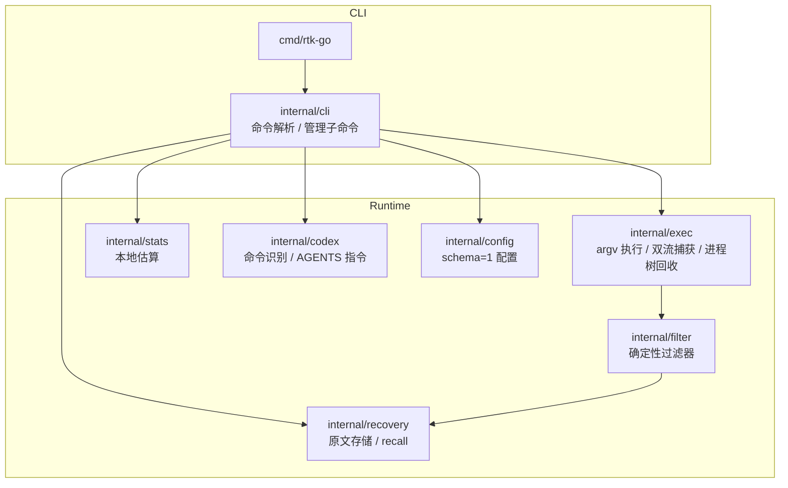

# 架构设计

`rtk-go` 的目标不是“改写命令”，而是在命令执行完成后，对已经产生的输出做一次
本地、确定性、可回退的降噪。核心约束：

- **单次执行**：参数、环境、cwd、stdin、两路输出和退出码必须保持；
- **纯过滤器**：过滤阶段不启动进程、不访问网络；
- **保守回退**：解析不确定、机器输出、TTY、无收益或原文不可用时直接透传；
- **可恢复**：任何有损候选都必须先完整保存原文，再允许进入模型上下文。

## 组件

| 包 | 职责 |
|---|---|
| `cmd/rtk-go` | 进程入口，把 `os.Args`/stdio 交给 `cli.App` |
| `internal/cli` | 解析 `exec`、管理子命令、错误码、输出编排 |
| `internal/exec` | 原生 executable 单次执行；stdin/stdout/stderr；Windows Job / Unix 进程组回收；有界捕获 |
| `internal/filter` | 每个命令形态一个纯函数过滤器；argv 选择器；UTF-8/ANSI 守卫 |
| `internal/recovery` | 原子写入、配额、过期清理、分页/raw recall |
| `internal/config` | schema=1 JSON、默认值、环境开关、禁用逻辑 |
| `internal/stats` | 本地调用计数/估算，不影响子进程 |
| `internal/codex` | 命令形状识别与保守重写决策；默认不自动改写 |

## 执行流程

1. `cli` 解析 `rtk-go exec [flags] -- <program> ...`，或从简写形式取首词作为程序。
2. `exec` 创建一次子进程，逐项透传 argv；stdout/stderr 并发 drain，避免互相阻塞。
3. 捕获超过内存预算或超时窗口时，转为流式输出并放弃过滤（回退原文）。
4. `filter.Select` 只对支持矩阵内的形态返回过滤器；未知命令为 `nil`。
5. `filter.Run` 做编码/ANSI 守卫并带 CPU deadline 执行纯转换，任何 panic/超时/格式异常都放弃候选。
6. 有损候选：完整原文原子写入 recovery，成功后才输出候选 + `[rtk-go recall <id>]`。
7. 无损候选/原文化：通过字节收益守卫后输出；收益不足也回退原文。
8. 子进程退出码原样返回；wrapper 生命周期错误使用 125/126/127，不与子进程退出码混淆。

## Profile 的取舍

| 维度 | safe | lossless | balanced | aggressive（默认） |
|---|---|---|---|---|
| 目标 | 不丢失正文信息 | 折叠连续重复行 | 保留正文，折叠格式 | 有界降噪 |
| 删除查询正文 | 否 | 否（编码次数） | 否 | 是，有界 |
| 依赖 recall | 否 | 是（保存原始字节） | 测试进度折叠时是 | 是 |
| 适合 | 低风险审计；逐字用 `--raw` | 高重复日志 | 日常查询 | Codex token 优化 |

`aggressive` 的省略点都在输出中显式标注（hidden 计数、`truncated`、失败块、`recall`
提示），不会把截断伪装成完整结果。

## 可恢复性

recovery 记录包含 stdout、stderr、退出码和编码标记；`recall` 默认按行分页，也支持
单流 `--raw` 逐字输出。原文目录使用用户私有权限，配额/过期清理只作用于受管对象。
`--no-store` 禁止任何有损过滤；如果原文无法完整保存，有损候选会回退原文。

## 扩展过滤器

新增过滤器的最小要求：

1. 只接收 `filter.Input`，输出 `filter.Output`，不产生副作用；
2. 显式声明 `Lossy`/`RemovedLines`；无损过滤器不得改变可观察正文；
3. 对不确定/机器格式返回 error，让上层回退；
4. 先写负向测试（畸形输入、超长行、非 UTF-8、收益不足），再接入支持矩阵；
5. 更新 `docs/usage.md` 与 `docs/security.md` 的边界说明。

## 非目标

- 不做 API 代理、会话上下文压缩或模型摘要；
- 不自动改写任意脚本/管道/写命令；
- 不把未验证的 hook 默认塞进用户 Codex 配置；
- 不承诺“无损”与“更高压缩率”同时成立：唯一信息无法被无损消除。
